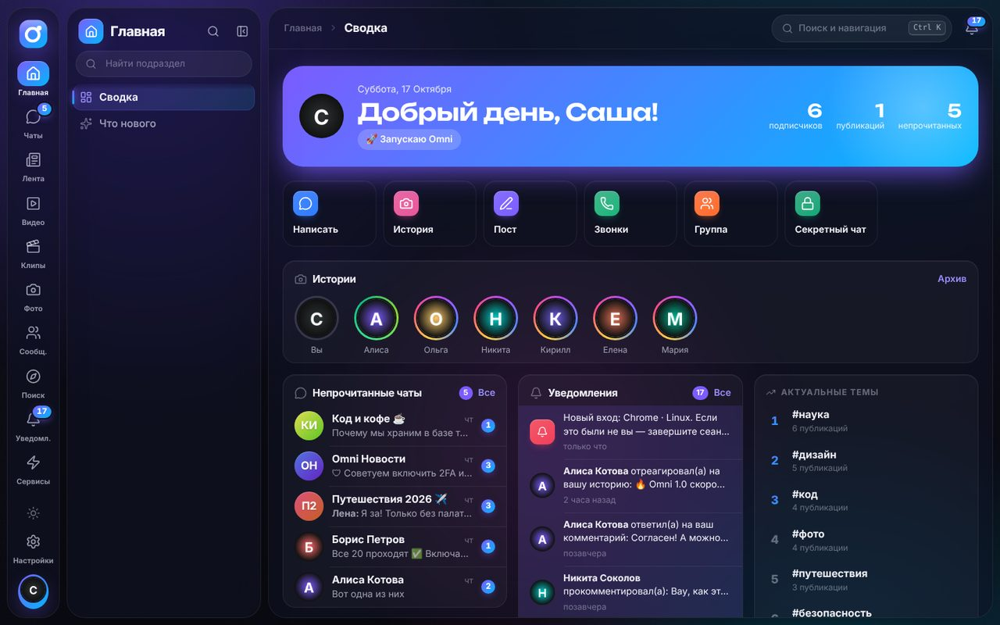
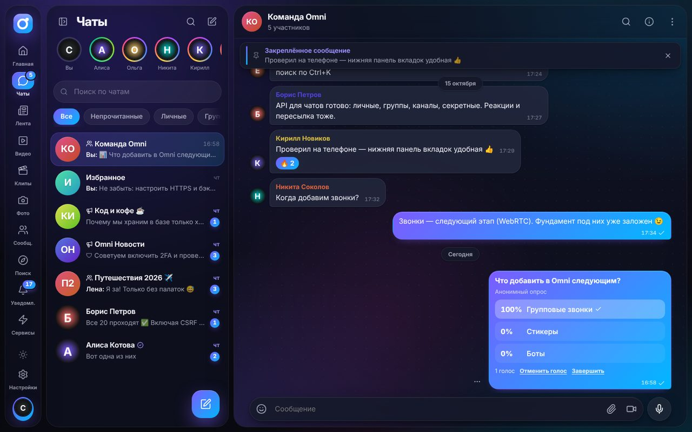
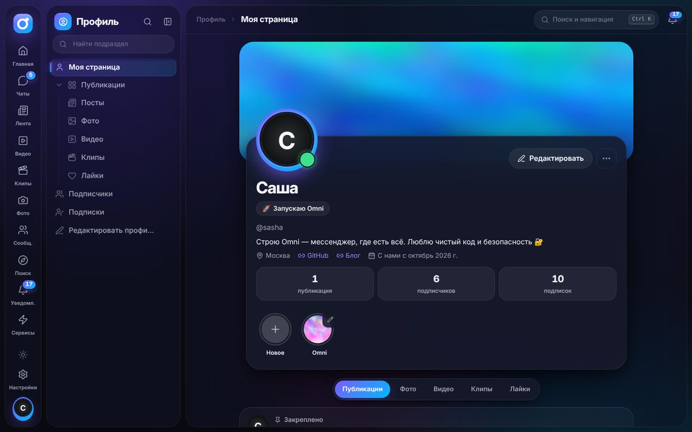
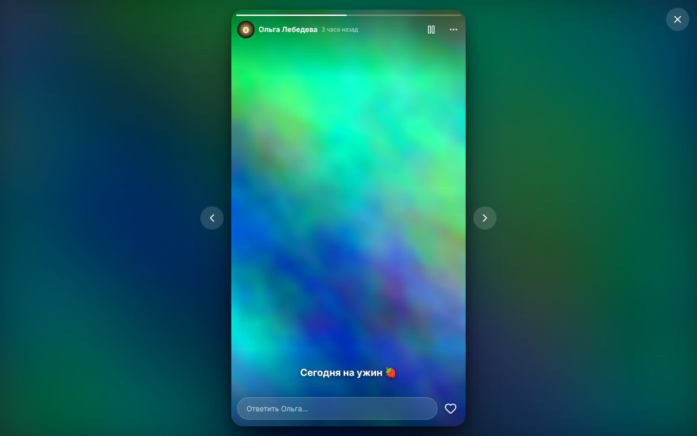
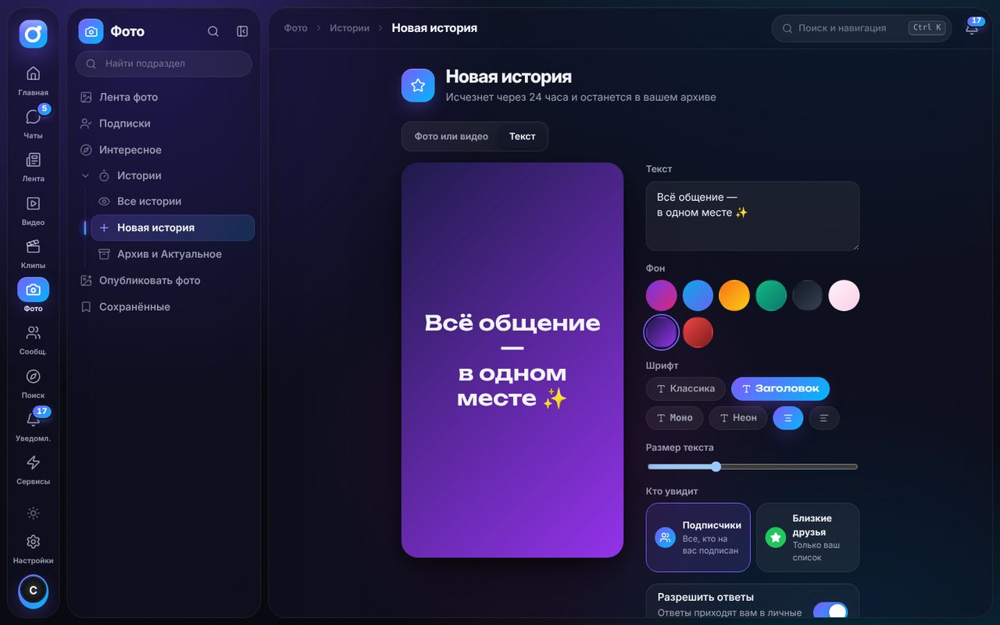
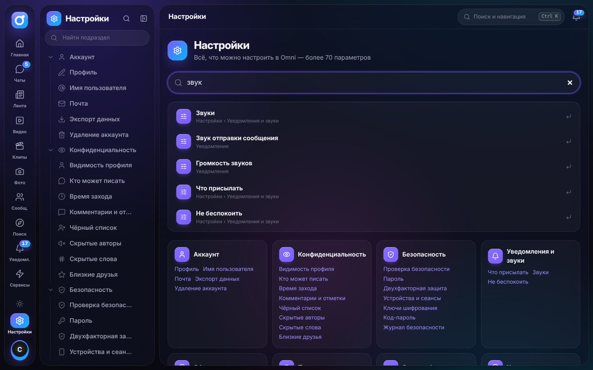
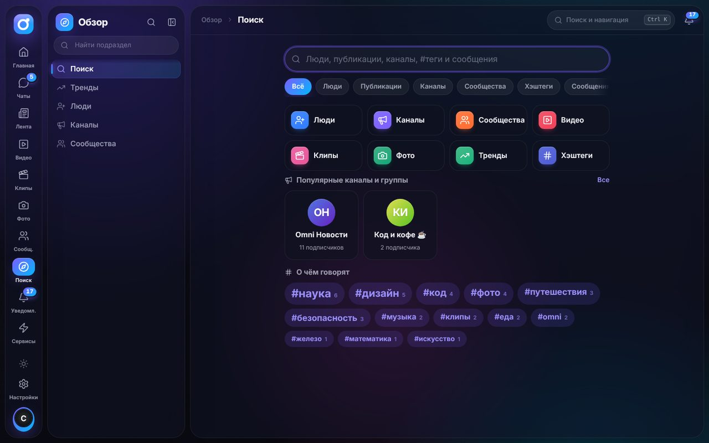
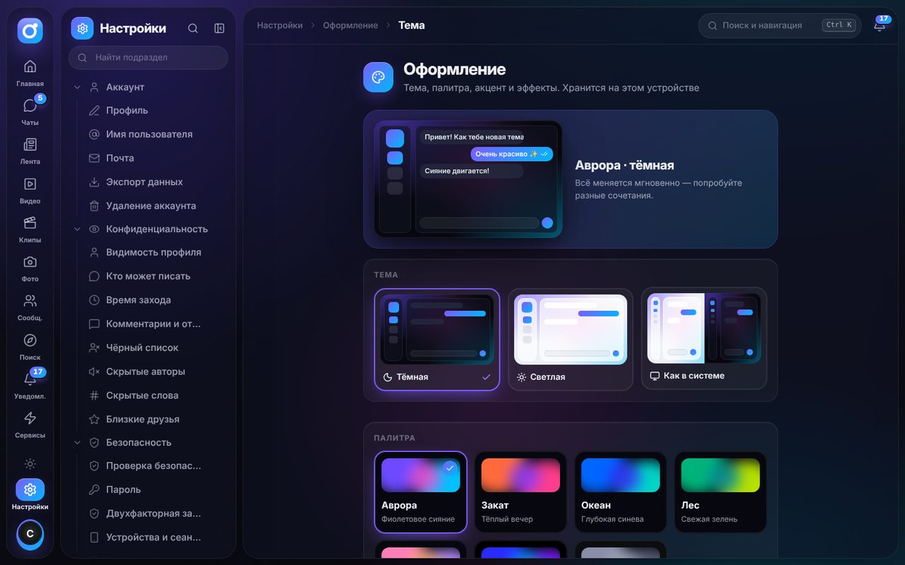
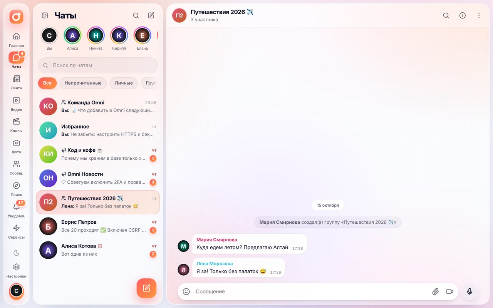

# Omni — всё общение в одном месте

**Omni** — прототип платформы «всё в одном»: мессенджер (как WhatsApp/Telegram), лента коротких постов (как X/Twitter), видео (как YouTube), вертикальные клипы (как TikTok), фото и истории (как Instagram) и сообщества — в одном приложении, с упором на **безопасность**, **мобильность** и **крепкий фундамент** для дальнейшего роста.



> Это фундамент: архитектура, безопасность, навигация и все базовые сценарии уже работают. Мелкие функции («мелочи») достраиваются поверх — см. [дорожную карту](docs/ROADMAP.md).

## Что уже работает

| Раздел | Возможности |
| --- | --- |
| 🏠 **Главная** | Сводка за день: приветствие и статус, быстрые действия, истории, непрочитанные чаты, уведомления, звонки, запланированные публикации, тренды; страница «Что нового» |
| 💬 **Мессенджер** | Личные чаты, группы, каналы, «Избранное»; **голосовые** (волна, перемотка, ×1.5/×2) и **видео-кружки**; **опросы и викторины**; **упоминания @** с подсказками; **отложенные** и «тихие» сообщения; выбор **эмодзи** с поиском по-русски; реакции, ответы, пересылка, редактирование, закреп; «печатает…/записывает…», «в сети», галочки прочтения и «кто прочитал»; **свои папки** с правилами; **пригласительные ссылки** со сроком и лимитом; **медленный режим** и **автоудаление**; **обои** (10 вариантов, свои у каждого чата); поиск по чату и **по всем сообщениям**; истории над списком чатов |
| 📞 **Звонки** | Аудио- и видеозвонки 1:1 на WebRTC (шифрование DTLS-SRTP), входящий экран с мелодией, свёрнутая плашка, выключение микрофона/камеры, история и пропущенные, перезвон в один тап; STUN/TURN настраиваются переменными окружения |
| 🔐 **Секретные чаты** | Сквозное шифрование на устройстве (ECDH P-256 → HKDF → AES-256-GCM), сервер хранит только шифротекст, сверка ключей по эмодзи/цифрам, таймер самоуничтожения |
| 📷 **Истории** | Фото/видео и **текстовые истории** на градиентах (4 шрифта), **реакции**, ответы в личку, **«Близкие друзья»** (зелёное кольцо), запрет ответов, **архив** всех историй и **«Актуальное»** в профиле, список просмотревших с реакциями |
| 📰 **Лента** | «Для вас», подписки, свежее, популярное; посты с фото/видео, репосты и цитаты, лайки и **«кто оценил»**, закладки и **коллекции**, **черновики** и **отложенные публикации**, **списки авторов** со своей лентой, **скрытые слова и #теги**, хэштеги и тренды, ветки комментариев |
| ▶️ **Видео** | Главная, подписки, тренды, страница просмотра с похожими видео, история с прогрессом, «Смотреть позже», понравившиеся, плейлисты, студия автора, загрузка с автоматической обложкой |
| 🎬 **Клипы** | Вертикальная лента с прокруткой «по одному», автозапуск, лайк двойным тапом, комментарии в шторке |
| 👥 **Сообщества** | Создание, вступление, общая лента участников, роли, закрытые сообщества |
| 🔎 **Обзор** | Категории, недавние запросы, популярные каналы, облако тегов, люди; поиск по людям, публикациям (FTS5), каналам, сообществам, #тегам и сообщениям с подсветкой |
| 🔔 **Уведомления** | Лайки, ответы, упоминания, подписки, заявки, реакции на истории, новые публикации авторов с «колокольчиком», события безопасности — в реальном времени, со звуком и на рабочем столе |
| 👤 **Профиль** | Обложка, аватар с кольцом историй, **статус** (эмодзи + текст, на время), **ссылки**, **закреплённая публикация**, «Актуальное», **общие подписчики**, «колокольчик», «в близкие друзья», «в список» |
| ✉️ **Почта** | Код подтверждения при регистрации, восстановление пароля по коду, вход по коду из письма (2FA), письма о входе с нового устройства; провайдеры Brevo / Resend / SMTP |
| ⚙️ **Настройки** | **Поиск по настройкам** (70+ параметров); аккаунт, статус и ссылки; приватность (закрытый профиль, кто пишет/видит «в сети», близкие друзья, скрытые слова, чёрный список); безопасность (2FA, сеансы, ключи, код-пароль, журнал); уведомления, **звуки** и **«Не беспокоить»** по расписанию; оформление (тема, 7 палитр, акцент, **шрифт**, **скругления**, плотность); **поведение** (стартовая страница, орфография, крупные эмодзи); обои; **энергосбережение** |

### Навигация-«лабиринт», в котором не заблудиться

Слева — полоса разделов, рядом — **дерево подразделов** (до 4 уровней, 150+ пунктов): папки, библиотеки, студии, вложенные настройки. Чтобы в нём не теряться:

- **Ctrl/⌘ + K** — навигатор: мгновенный переход в любой раздел, к людям, каналам и #тегам;
- хлебные крошки в шапке показывают, где вы находитесь;
- ⭐ любой пункт можно закрепить в «Избранных разделах»;
- фильтр по дереву, Alt+1…9 — переключение разделов;
- разделы «в разработке» уже стоят на своих местах и показывают, что в них появится.


### На телефоне

Адаптивный интерфейс и PWA (устанавливается на главный экран): нижние вкладки, переписка на весь экран, всё дерево разделов — в шторке «Ещё».


## Опубликовать сайт в один клик

[](https://render.com/deploy?repo=https://github.com/sashka1999in23594-sketch/Messenger)

1. Нажмите кнопку выше и войдите в Render через GitHub (бесплатно, карта не нужна).
2. Нажмите **Deploy Blueprint** — Render сам соберёт проект по [`render.yaml`](render.yaml), сгенерирует `APP_SECRET` и включит HTTPS.
3. Через 3–5 минут сайт откроется по адресу вида `https://omni-xxxx.onrender.com`. Вход: **`sasha`** / **`omni-demo-2026`**.

После этого каждый `git push` в `main` обновляет сайт автоматически. Особенности бесплатного тарифа: сервис «засыпает» после 15 минут без посетителей (первое открытие — ~30 секунд), а диск временный — после перезапуска база создаётся заново с демо-данными. Для постоянного хранения подключите в Render диск и задайте `DATA_DIR=/var/data`.

### Письма на почту (коды при регистрации, входе и восстановлении пароля)

На бесплатном Render SMTP-порты закрыты, поэтому письма отправляются через HTTPS-API **Brevo** (бесплатно 300 писем в день, свой домен не нужен):

1. Зарегистрируйтесь на [brevo.com](https://www.brevo.com), в разделе **Senders, Domains & Dedicated IPs → Senders** добавьте и подтвердите свою почту (например, Gmail) — от её имени будут уходить письма.
2. В **SMTP & API → API Keys** создайте ключ (начинается с `xkeysib-`).
3. В Render откройте сервис → **Environment** и задайте `BREVO_API_KEY` = ключ, `MAIL_FROM` = `Omni <ваша-почта@gmail.com>`. Сервис перезапустится сам.

Без этих настроек всё работает, кроме писем: подтверждение почты, вход по коду из письма и восстановление пароля будут недоступны (коды никогда не показываются на экране — это было бы небезопасно). Также поддерживаются `RESEND_API_KEY` и `SMTP_URL` — см. [.env.example](.env.example). При локальной разработке письма видны прямо на экране входа: кнопка «Тестовая почта».

## Быстрый старт

Нужен **Node.js 22.13+** (встроенный `node:sqlite`, никаких нативных модулей и внешней БД).

```bash
npm install
npm run seed      # демо-данные: пользователи, посты, видео, клипы, чаты
npm run dev       # API на :4000 и веб-клиент на :5173
```

Откройте **http://localhost:5173** и войдите как **`sasha`** / **`omni-demo-2026`** (или `alice`, `boris`, `maria`, `elena`, `kirill`, `nikita`, `olga` — пароль тот же).

**С телефона:** запустите `npm run dev` на компьютере и откройте `http://<IP-компьютера>:5173` в той же Wi-Fi-сети.

**Проверить секретный чат:** откройте приложение в двух разных браузерах (или обычном + инкогнито), войдите разными пользователями и начните секретный чат из профиля собеседника.

### Production

```bash
npm run build
cd apps/server && NODE_ENV=production APP_SECRET="$(openssl rand -base64 48)" PUBLIC_ORIGIN=https://ваш-домен npm start
```

Сервер сам раздаёт собранный клиент (один origin). Или через Docker:

```bash
APP_SECRET="$(openssl rand -base64 48)" docker compose up -d
```

Для доступа из интернета поставьте перед сервисом обратный прокси с HTTPS (Caddy/Nginx) и задайте `TRUST_PROXY=1`, `PUBLIC_ORIGIN=https://…`. Все переменные окружения — в [.env.example](.env.example).

## Команды

| Команда | Что делает |
| --- | --- |
| `npm run dev` | Сервер + клиент с горячей перезагрузкой |
| `npm run seed` | Демо-данные (`npm run seed -- --reset` — пересоздать) |
| `npm run typecheck` | Проверка типов во всех пакетах |
| `npm test` | Тесты: безопасность API, почта и 2FA, мессенджер и звонки, истории и соцфункции, политика паролей, разбор текста, навигация без тупиков |
| `npm run build` | Production-сборка сервера и клиента |
| `npm start` | Запуск собранного сервера |

## Структура

```
apps/
  server/            API: Fastify 5 + node:sqlite, REST + WebSocket
    src/modules/     auth · mail · users · policy · chats · calls · keys · posts · social · media · stories · communities · notifications · search · reports · realtime
    test/            интеграционные тесты безопасности
  web/               клиент: React 19 + Vite + TanStack Query + Zustand, PWA
    src/app/         оболочка, навигация (реестр разделов), маршруты, сессия, реалтайм
    src/features/    home · chats · calls · stories · feed · posts · social · video · shorts · photos · communities · explore · notifications · profile · settings · onboarding
    src/shared/      api-клиент, UI-кит, E2E-криптография, хуки, сторы
packages/
  shared/            общий контракт: zod-схемы, типы API, протокол WebSocket, константы
docs/                архитектура, безопасность, дорожная карта, как добавлять разделы
```

## Документация

- [Архитектура](docs/ARCHITECTURE.md) — слои, модель данных, реалтайм, как масштабировать
- [Безопасность](docs/SECURITY.md) — модель угроз и что уже защищено
- [Дорожная карта](docs/ROADMAP.md) — что дальше
- [Как добавить раздел или функцию](docs/CONTRIBUTING.md)

## Скриншоты

| | |
| --- | --- |
|  |  |
|  |  |
|  |  |
|  |  |
|  |  |
|  |  |

## Лицензия

Лицензия пока не выбрана — все права принадлежат владельцу репозитория. Если планируете открыть код, добавьте файл `LICENSE` (например, MIT или AGPL-3.0).
