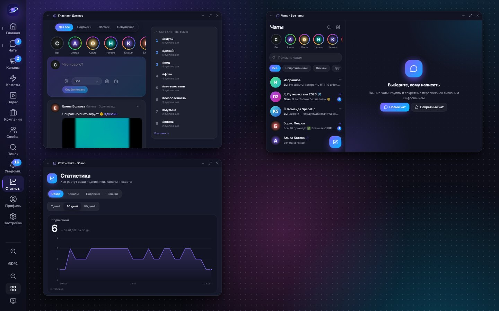
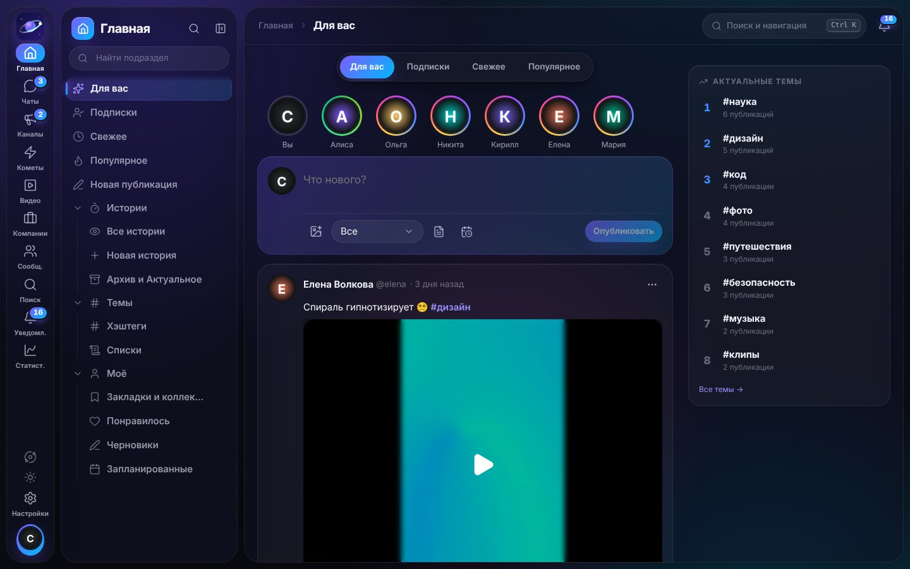
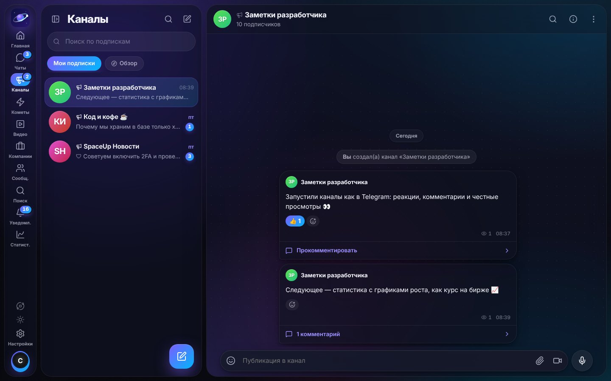
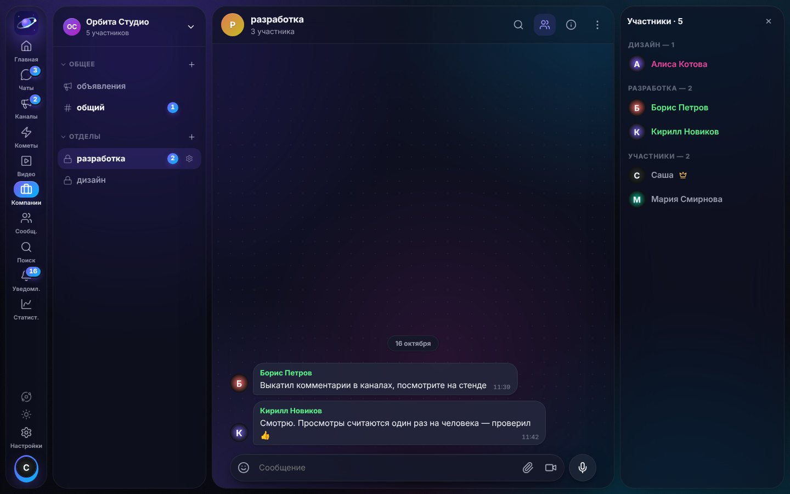
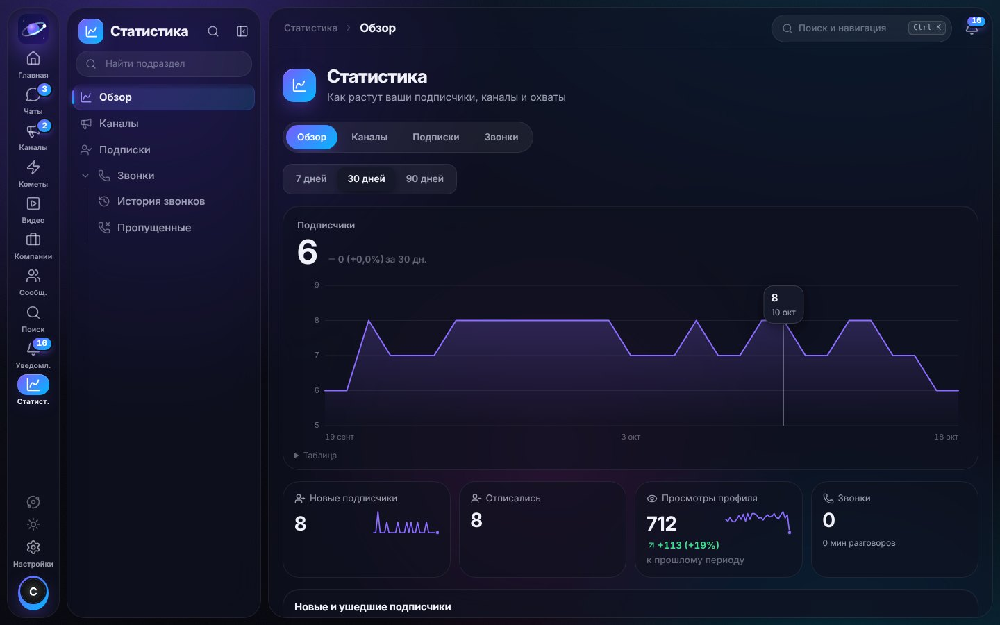
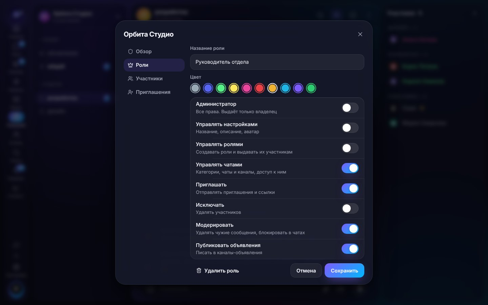
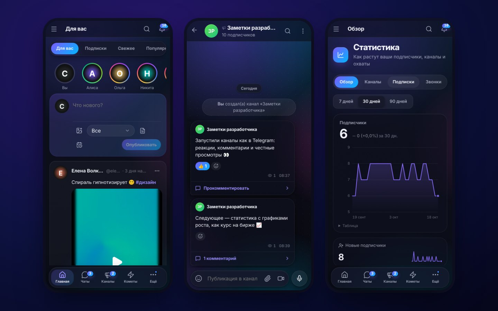

# Sunnet

**Sunnet** — мессенджер и социальная платформа: чаты и звонки, каналы как в Telegram, короткие видео Reels, лента, видео, компании в стиле Discord и большие сообщества. С упором на **безопасность**, **мобильность** и **крепкий фундамент** для роста.



## Что умеет

| Раздел | Возможности |
| --- | --- |
| 🏠 **Главная** | Лента сразу при входе: истории, публикации с фото и видео, «Для вас», подписки, свежее, популярное; закладки и коллекции, черновики и отложенные публикации, списки авторов, скрытые слова, хэштеги |
| 💬 **Чаты** | Личные, группы (открытые и закрытые), секретные чаты, «Избранное»; голосовые и видео-кружки, опросы, упоминания @, отложенные и «тихие» сообщения, реакции, ответы, пересылка, закрепы, «кто прочитал»; свои папки, ссылки-приглашения со сроком и лимитом, медленный режим, автоудаление, обои, поиск по всем сообщениям |
| 📣 **Каналы** | Как в Telegram: публикуют владелец и назначенные им администраторы; реакции под постами, честные просмотры (один человек — один просмотр), комментарии с модерацией, блокировки на срок или навсегда, открытые и закрытые каналы, обзор каналов |
| 🎞️ **Reels** | Короткие вертикальные видео: листаются по одному, автозапуск, лайк двойным тапом, комментарии; загрузка своих роликов |
| 🎬 **Видео** | Как на YouTube: чипы-фильтры, сетка с превью при наведении, плеер со скоростью, главами, PiP, кинотеатром и горячими клавишами, мини-плеер, «Далее» с автовоспроизведением, подписки, тренды, история с прогрессом, плейлисты, «Смотреть позже», студия автора |
| 🔴 **Прямые эфиры** | Эфир с камеры или демонстрации экрана (со звуком) прямо из браузера, до 50 зрителей без медиасервера, чат эфира, счётчик зрителей, подписчики получают уведомление; после эфира запись можно опубликовать в «Видео» |
| 🎞️ **Премьеры** | Видео выходит в назначенное время: обратный отсчёт, «Напомнить» (уведомление в момент начала), чат ожидания; во время премьеры все смотрят синхронно с общего места, затем — обычное видео |
| 💼 **Компании** | В стиле Discord: только по приглашению руководителя (оно приходит в уведомления — «Принять» или «Отклонить»); роли с цветом и правами, категории, чаты и каналы-объявления, чаты только для нужных ролей; участники по ролям, имена в переписке — цветом роли |
| 👥 **Сообщества** | Открытые (вступает кто хочет) и закрытые (по приглашению или ссылке); внутри много групп — вступаете в те, что интересны; модераторы и роли |
| 📈 **Статистика** | Рост подписчиков как курс на бирже (график с перекрестием и подсказками), новые и ушедшие подписчики по дням, просмотры профиля, каналы: подписчики, просмотры по дням, лучшие посты; подписки |
| 🖥 **Компьютер** | На компьютере каждый раздел — окно на рабочем столе: строка меню, док с увеличением, прилипание к краям и четвертям, подразделы в боковой панели окна, поиск Ctrl/⌘+K, горячие клавиши, обои; на телефоне и планшете — мобильное оформление в стиле Telegram |
| 📞 **Звонки** | Аудио и видео 1:1 и групповые до 50 человек на WebRTC (шифрование DTLS-SRTP). На компьютере звонок — окно с сетками 2×2/3×3/4×4 и боковой панелью, закреплением участника, демонстрацией экрана, чатом и студией трансляции (текст, фото, видео, экран, камера, фоны); на телефоне — как в мессенджерах. История, пропущенные, «+» — новый звонок из чатов или по @имени |
| 🔐 **Секретные чаты** | Сквозное шифрование на устройстве (ECDH P-256 → HKDF → AES-256-GCM), сервер хранит только шифротекст, сверка ключей, таймер самоуничтожения |
| 🔎 **Поиск** | Одна строка: люди по имени, @username и **номеру телефона**, каналы, группы, сообщества, публикации и ваши сообщения |
| 🔑 **Вход и регистрация** | На компьютере — голубое небо с солнцем и бликами в углу, посередине карточка с одним полем на шаг; на телефоне — только поля на весь экран. Вход: почта или телефон → код (в письмо и в чат Sunnet, лимит 2 кода за 30 минут, «Отправить снова» через 30 секунд) → пароль с подсказкой. «Забыли пароль?» — два кода (почта + чат Sunnet, 4 сброса в час). Вход по QR-коду с устройства, где вы уже вошли. Регистрация по слайдам с обязательным подтверждением почты, без эмодзи в имени и @username |
| 🛰️ **Чат Sunnet** | Служебный чат у каждого, из него нельзя выйти: коды входа с системой, браузером и IP, уведомления о входе с нового устройства и сбросе пароля, позже — новости обновлений |
| 🎂 **Дни рождения** | Дата рождения и пол при регистрации; в день рождения — письмо и поздравление в чате Sunnet, подписчикам и собеседникам — напоминание «Поздравить» |
| 💻 **Приложения** | Для Windows, macOS и Linux (страница «Скачать», сборки — в GitHub Releases), установка из браузера как PWA |
| ❓ **Помощь** | Отдельный сайт: частые вопросы (в том числе почему не работают звонки), сотрудничество, политика конфиденциальности, условия, почта поддержки spaceup.support@gmail.com |
| ⚙️ **Настройки** | Поиск по настройкам; приватность, безопасность (2FA, сеансы, ключи, код-пароль, журнал), уведомления и звуки, «Не беспокоить», оформление (тема, палитры, акцент, шрифт, скругления), стартовая страница, энергосбережение, рабочий стол и обои |

Навигация: слева разделы, рядом — дерево подразделов (до 4 уровней, ваши компании и сообщества появляются прямо в нём), **Ctrl/⌘ + K** — мгновенный переход куда угодно. На телефоне — нижние вкладки, переписка на весь экран, PWA ставится на главный экран.

## Опубликовать сайт в один клик

[](https://render.com/deploy?repo=https://github.com/sashka1999in23594-sketch/Messenger)

1. Нажмите кнопку и войдите в Render (через Google или почту; GitHub подключается только для обновлений из репозитория).
2. Нажмите **Deploy Blueprint** — Render соберёт проект по [`render.yaml`](render.yaml), сгенерирует `APP_SECRET` и включит HTTPS. Базу данных (Postgres) создавать не нужно.
3. Через 3–5 минут сайт откроется по адресу вида `https://omni-xxxx.onrender.com`. Зарегистрируйтесь — демо-данных в публичной версии нет.

После этого каждый `git push` в `main` обновляет сайт сам.

> ⚠️ **На бесплатном тарифе Render диск временный**: при каждом «засыпании» (15 минут без посетителей), перезапуске и деплое файлы сервера стираются. Чтобы аккаунты, переписки и видео не пропадали, подключите бесплатное хранилище — см. [«Данные не пропадают»](#данные-не-пропадают). Другой путь — платный тариф **Starter** с **Disk** (путь `/var/data`) и `DATA_DIR=/var/data`.

### Данные не пропадают

Sunnet хранит копию базы и все загруженные файлы во внешнем S3-совместимом хранилище. При старте на чистом диске база восстанавливается из последней копии, а файлы скачиваются обратно при первом открытии. Копия базы отправляется раз в минуту, если что-то изменилось, и при остановке сервиса. Бесплатно и без банковской карты — **Backblaze B2** (10 ГБ):

1. Зарегистрируйтесь на [backblaze.com](https://www.backblaze.com/sign-up/cloud-storage) — регион лучше **EU Central** (ближе к Render во Франкфурте) — и подтвердите почту.
2. **Buckets → Create a Bucket**: уникальное имя (например, `sunnet-ваше-имя`), **Files in Bucket: Private**, **Default Encryption: Enable**. На карточке бакета скопируйте **Endpoint** — вида `s3.eu-central-003.backblazeb2.com`.
3. **Application Keys → Add a New Application Key**: доступ только к этому бакету, **Read and Write**. Скопируйте **keyID** и **applicationKey** (второй показывается один раз).
4. В Render: сервис → **Environment**: `S3_ENDPOINT` = Endpoint, `S3_BUCKET` = имя бакета, `S3_ACCESS_KEY_ID` = keyID, `S3_SECRET_ACCESS_KEY` = applicationKey. Сервис перезапустится сам.
5. В логах Render (**Logs**) появится «Хранилище …: копии ещё нет — начинаем с новой базы», а вскоре — «Копия базы сохранена в хранилище». С этого момента всё переживает засыпание и деплой.

Подойдёт любое S3-совместимое хранилище: Cloudflare R2 (`https://<account>.r2.cloudflarestorage.com`), Yandex Object Storage (`https://storage.yandexcloud.net`), AWS S3, свой MinIO. Ключи остаются на сервере. Бакет должен быть **приватным**: в копии базы хэши паролей и переписки.

Всё лежит в папке `spaceup/` бакета: `db/latest.db.gz` — последняя копия, `db/day-0…6.db.gz` — дневные копии за неделю, `media/` — файлы. Прежние версии копий удаляются сами, чтобы не тратить бесплатный объём. Откатиться на день назад: в Render нажмите **Suspend Service** (сервис сохранит последнюю копию и остановится), в бакете замените `db/latest.db.gz` нужной `day-N` (скачать и загрузить под этим именем), затем **Resume Service**. Может потеряться только то, что сделано за последнюю минуту перед аварийным падением сервера, или за несколько секунд переключения во время деплоя.

Всё в бакете зашифровано (AES-256-GCM) ключом, который сервер выводит из `APP_SECRET`: даже с ключами от бакета копии базы и файлы не прочитать. Поэтому **не меняйте `APP_SECRET`** после запуска — без него сервер не сможет расшифровать свои копии. Файлы, сохранённые до включения шифрования, сервер перешифровывает сам в фоне.

### Коды на почту

Письма с кодами (подтверждение почты, вход по коду, сброс пароля) можно отправлять прямо с вашего Gmail — без сторонних сервисов, номера телефона и своего домена. Бесплатно до 100 писем в день, письма приходят от вашего настоящего адреса.

1. Откройте [script.google.com](https://script.google.com) → **Новый проект**, сотрите всё и вставьте код из [docs/gmail-mailer.gs](docs/gmail-mailer.gs).
2. В строке `const SECRET = '…'` впишите любой длинный пароль (от 16 символов) и сохраните (💾).
3. **Развернуть → Новое развёртывание** → шестерёнка → **Веб-приложение**: «Запуск от имени» — **Я**, «У кого есть доступ» — **Все** → **Развернуть** → **Предоставить доступ** → ваш аккаунт → «Дополнительные настройки» → «Перейти на страницу…» → **Разрешить**. Скопируйте **URL веб-приложения** (заканчивается на `/exec`).
4. В Render: **Environment** → `MAIL_SCRIPT_URL` = этот адрес, `MAIL_SCRIPT_SECRET` = пароль из шага 2 → **Save and deploy**.

Проверка: `<адрес сайта>/api/v1/health` — `"mail":"ok"`. `bad_key` — пароль в Render и в скрипте не совпадает; `script_access` — в шаге 3 доступ не «Все».

Другие способы: Brevo (`BREVO_API_KEY` + подтверждённый отправитель в `MAIL_FROM`; при регистрации просит телефон), Resend (`RESEND_API_KEY`, нужен свой домен), SMTP (`SMTP_URL`; на бесплатном Render SMTP-порты закрыты). Для Brevo в `/health` бывают `sender_not_verified` и `ip_blocked` (Brevo → **Security → Authorized IPs** → отключить блокировку).

Почта обязательна для production: регистрация подтверждает адрес кодом, а код входа приходит и в письмо, и в чат Sunnet. Без почты код входа попадёт только в чат Sunnet на устройствах, где вы уже вошли (или войдите по QR-коду). Коды никогда не показываются на экране — это было бы небезопасно.

### Звонки в любых сетях

Звонок идёт напрямую между устройствами. Когда оба в обычных сетях, этого хватает, но мобильные операторы и многие роутеры прячут абонентов за общим NAT — тогда звонит, а разговор не соединяется. Для этого нужен **TURN** — сервер-посредник (поток через него идёт в зашифрованном виде). Бесплатно — у Cloudflare:

1. Зарегистрируйтесь на [dash.cloudflare.com](https://dash.cloudflare.com), откройте **Realtime → TURN Server** и создайте ключ — вы получите **Token ID** и **API Token**.
2. В Render: сервис → **Environment** → `CF_TURN_KEY_ID` = Token ID, `CF_TURN_API_TOKEN` = API Token.
3. Откройте **Настройки → Звонки → Проверить звонки**: строка «Резервный маршрут (TURN)» должна стать зелёной.

Временные логин и пароль TURN сервер получает сам на каждый звонок — ключ Cloudflare в браузер не попадает. Вместо Cloudflare подойдут Metered (`METERED_TURN_URL`) или свой coturn (`TURN_URLS`, `TURN_USERNAME`, `TURN_CREDENTIAL`). Если соединиться всё же не удалось, звонок через 30 секунд завершится с понятной причиной, а при кратком обрыве связи во время разговора Sunnet сам перезапустит соединение.

## Быстрый старт (локально)

Нужен **Node.js 22.13+** (встроенный `node:sqlite`, без внешней БД и нативных модулей).

```bash
npm install
npm run seed      # демо-данные: люди, посты, каналы, компания, сообщество, статистика
npm run dev       # API на :4000 и клиент на :5173
```

Откройте **http://localhost:5173**, введите почту демо-пользователя, например **`sasha@example.com`** (или `alice@…`, `boris@…`, `maria@…`, `elena@…`, `kirill@…`, `nikita@…`, `olga@…`), код возьмите из «Тестовой почты» под формой, пароль — **`spaceup-demo-2026`**. «Тестовая почта» есть только в разработке.

**С телефона:** запустите `npm run dev` и откройте `http://<IP-компьютера>:5173` в той же Wi-Fi-сети.

### Production

```bash
npm run build
cd apps/server && NODE_ENV=production APP_SECRET="$(openssl rand -base64 48)" PUBLIC_ORIGIN=https://ваш-домен npm start
```

Сервер сам раздаёт собранный клиент. Или Docker: `APP_SECRET="$(openssl rand -base64 48)" docker compose up -d`. За обратным прокси с HTTPS задайте `TRUST_PROXY=1` и `PUBLIC_ORIGIN=https://…`. Все переменные — в [.env.example](.env.example).

## Команды

| Команда | Что делает |
| --- | --- |
| `npm run dev` | Сервер + клиент с горячей перезагрузкой |
| `npm run seed` | Демо-данные (`npm run seed -- --reset` — пересоздать) |
| `npm run typecheck` | Проверка типов во всех пакетах |
| `npm test` | Тесты: безопасность API, вход по шагам и QR, лимиты кодов, почта и 2FA, мессенджер, каналы, компании и сообщества, статистика, звонки, соцфункции, телефон, навигация без тупиков |
| `npm run build` | Production-сборка |
| `npm start` | Запуск собранного сервера |

## Структура

```
apps/
  server/            API: Fastify 5 + node:sqlite, REST + WebSocket
    src/modules/     auth (вход по шагам, QR, регистрация) · system (чат Sunnet, дни рождения) · mail · users · policy · chats · calls · keys · posts · social · media · stories
                     spaces (компании и сообщества) · stats · notifications · search · reports · realtime
    test/            интеграционные тесты
  web/               клиент: React 19 + Vite + TanStack Query + Zustand, PWA
    src/app/         оболочка, реестр навигации, маршруты, сессия, реалтайм
    src/features/    chats (и каналы) · calls · spaces · stats · desktop (рабочий стол на ПК) · feed · posts · social
                     stories · video · shorts (Reels) · explore (поиск) · notifications · profile · settings
                     auth (вход, регистрация, «Скачать», небо с солнцем на CSS) · help (сайт помощи)
    src/shared/      API-клиент, UI-кит, E2E-криптография, хуки, сторы
packages/
  shared/            общий контракт: zod-схемы, типы API, протокол WebSocket, права, константы
desktop-app/         приложение для Windows, macOS и Linux (Electron), собирается в GitHub Actions
docs/                архитектура, безопасность, дорожная карта, как добавлять разделы
```

## Документация

- [Архитектура](docs/ARCHITECTURE.md) — слои, модель данных, реалтайм, как масштабировать
- [Безопасность](docs/SECURITY.md) — модель угроз и что уже защищено
- [Дорожная карта](docs/ROADMAP.md) — что дальше
- [Как добавить раздел или функцию](docs/CONTRIBUTING.md)

## Скриншоты

| | |
| --- | --- |
|  |  |
|  |  |
|  |  |

## Лицензия

Лицензия пока не выбрана — все права принадлежат владельцу репозитория. Если планируете открыть код, добавьте файл `LICENSE` (например, MIT или AGPL-3.0).
