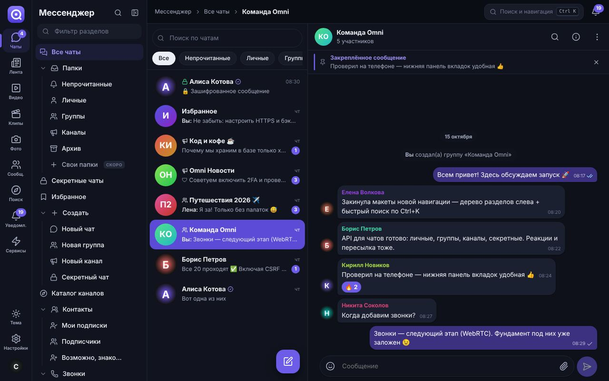
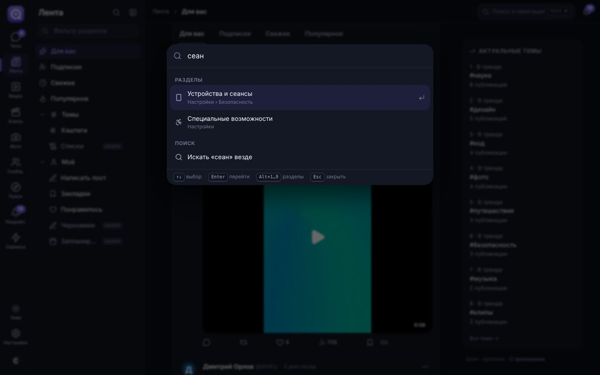
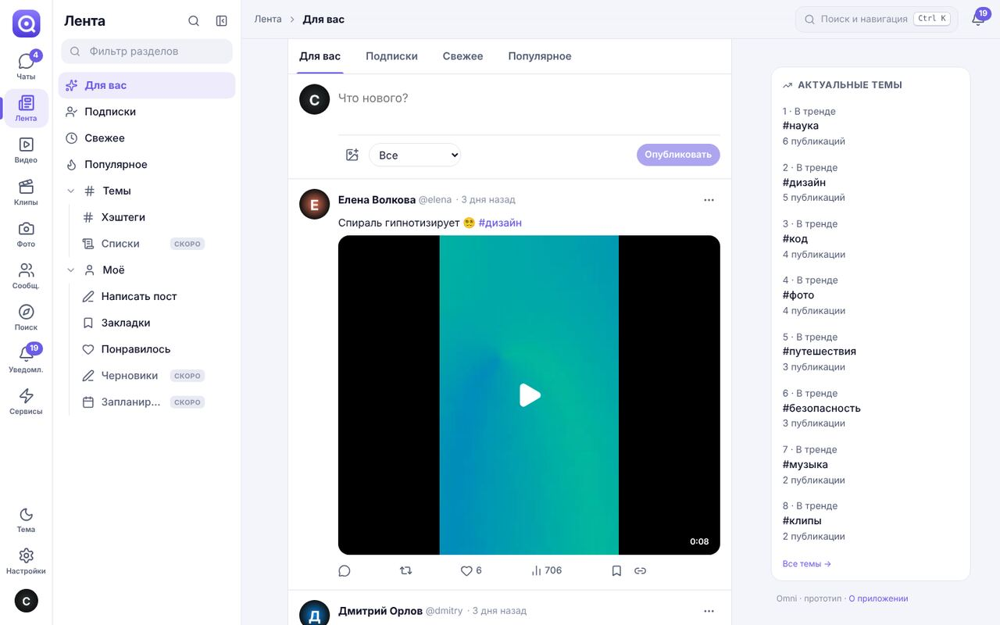
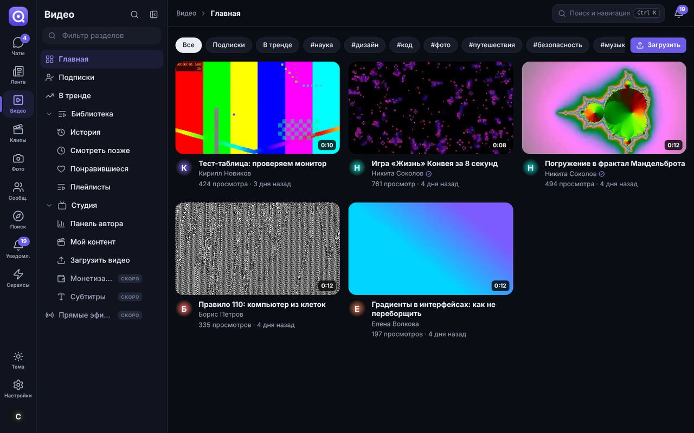
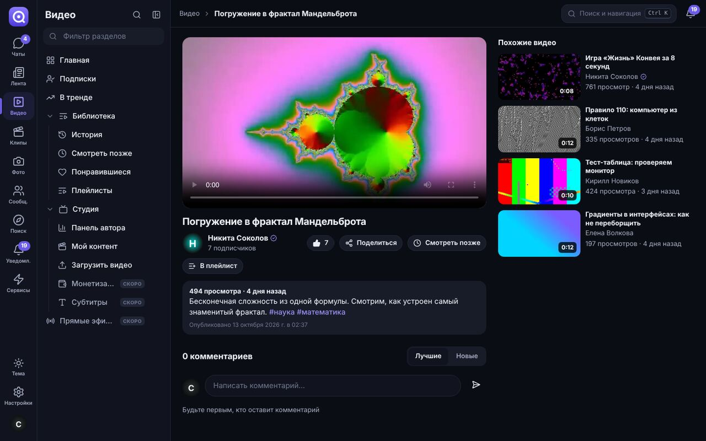
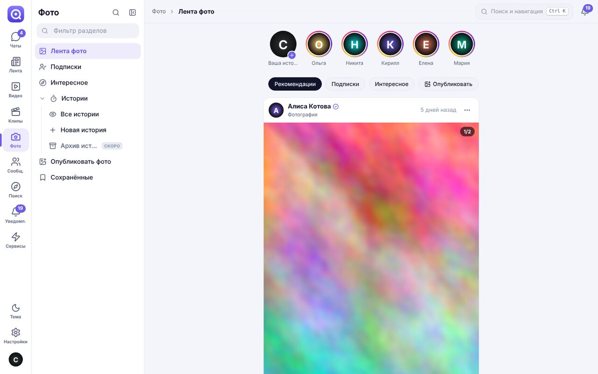
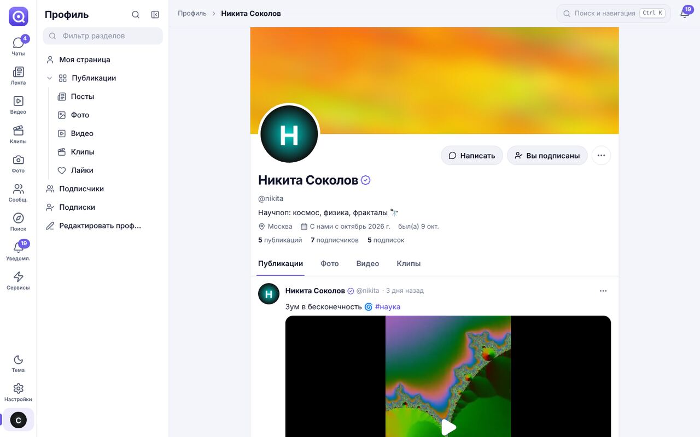
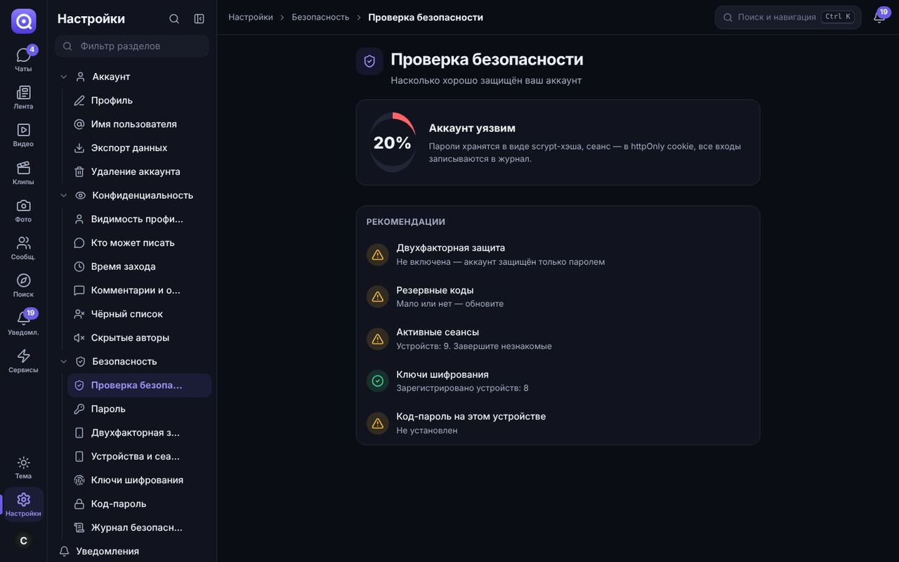

# Omni — всё общение в одном месте

**Omni** — прототип платформы «всё в одном»: мессенджер (как WhatsApp/Telegram), лента коротких постов (как X/Twitter), видео (как YouTube), вертикальные клипы (как TikTok), фото и истории (как Instagram) и сообщества — в одном приложении, с упором на **безопасность**, **мобильность** и **крепкий фундамент** для дальнейшего роста.



> Это фундамент: архитектура, безопасность, навигация и все базовые сценарии уже работают. Мелкие функции («мелочи») достраиваются поверх — см. [дорожную карту](docs/ROADMAP.md).

## Что уже работает

| Раздел | Возможности |
| --- | --- |
| 💬 **Мессенджер** | Личные чаты, группы, каналы (публичные и закрытые), «Избранное», папки (личные/группы/каналы/непрочитанные/архив), закреп чатов и сообщений, реакции, ответы, пересылка, редактирование (↑ в пустом поле), удаление у себя/у всех, вложения (фото/видео/файлы), «печатает…», «в сети», двойные галочки прочтения, поиск по чату, общие медиа, управление участниками и ролями, каталог каналов |
| 🔐 **Секретные чаты** | Сквозное шифрование на устройстве (ECDH P-256 → HKDF → AES-256-GCM), сервер хранит только шифротекст, сверка ключей по эмодзи/цифрам, таймер самоуничтожения |
| 📰 **Лента** | «Для вас» (ранжирование по вовлечённости с затуханием), подписки, свежее, популярное; посты с фото/видео, репосты и цитаты, лайки, закладки, хэштеги и тренды, упоминания, ветки комментариев |
| ▶️ **Видео** | Главная, подписки, тренды, страница просмотра с похожими видео, история с прогрессом, «Смотреть позже», понравившиеся, плейлисты, студия автора (статистика, контент), загрузка с автоматической обложкой |
| 🎬 **Клипы** | Вертикальная лента с прокруткой «по одному», автозапуск видимого клипа, лайк двойным тапом, комментарии в шторке, управление с клавиатуры |
| 📷 **Фото и истории** | Лента фото с каруселью, истории на 24 часа (просмотрщик с прогрессом, паузой, ответом в личку, списком просмотревших), «Интересное», сохранённые |
| 👥 **Сообщества** | Создание, вступление, общая лента участников, роли, закрытые сообщества |
| 🔎 **Обзор** | Глобальный поиск (люди, публикации FTS5, каналы, сообщества, #теги), тренды, рекомендации людей |
| 🔔 **Уведомления** | Лайки, ответы, упоминания, подписки, заявки в закрытый профиль, события безопасности — в реальном времени |
| 👤 **Профиль** | Обложка, аватар, био, подписки/заявки, вкладки контента, «Написать», «Секретный чат», скрыть, заблокировать, пожаловаться |
| ⚙️ **Настройки** | Профиль, имя пользователя, экспорт данных, удаление аккаунта; приватность (закрытый профиль, кто пишет/комментирует/видит «в сети», отчёты о прочтении, чёрный список); безопасность (проверка безопасности, пароль, 2FA с QR и резервными кодами, сеансы, ключи шифрования, код-пароль, журнал входов); уведомления; тема, акцент, размер текста, плотность; горячие клавиши; модерация жалоб |

### Навигация-«лабиринт», в котором не заблудиться

Слева — полоса разделов, рядом — **дерево подразделов** (до 4 уровней, 150+ пунктов): папки, библиотеки, студии, вложенные настройки. Чтобы в нём не теряться:

- **Ctrl/⌘ + K** — навигатор: мгновенный переход в любой раздел, к людям, каналам и #тегам;
- хлебные крошки в шапке показывают, где вы находитесь;
- ⭐ любой пункт можно закрепить в «Избранных разделах»;
- фильтр по дереву, Alt+1…9 — переключение разделов;
- разделы «в разработке» уже стоят на своих местах и показывают, что в них появится.



### На телефоне

Адаптивный интерфейс и PWA (устанавливается на главный экран): нижние вкладки, переписка на весь экран, всё дерево разделов — в шторке «Ещё».


## Быстрый старт

Нужен **Node.js 22.13+** (встроенный `node:sqlite`, никаких нативных модулей и внешней БД).

```bash
npm install
npm run seed      # демо-данные: пользователи, посты, видео, клипы, чаты
npm run dev       # API на :4000 и веб-клиент на :5173
```

Откройте **http://localhost:5173** и войдите как **`sasha`** / **`omni-demo-2026`** (или `alice`, `boris`, `maria`, `elena`, `kirill`, `nikita`, `olga` — пароль тот же).

**С телефона:** запустите `npm run dev` на компьютере и откройте `http://<IP-компьютера>:5173` в той же Wi-Fi-сети.

**Проверить секретный чат:** откройте приложение в двух разных браузерах (или обычном + инкогнито), войдите разными пользователями и начните секретный чат из профиля собеседника.

### Production

```bash
npm run build
cd apps/server && NODE_ENV=production APP_SECRET="$(openssl rand -base64 48)" PUBLIC_ORIGIN=https://ваш-домен npm start
```

Сервер сам раздаёт собранный клиент (один origin). Или через Docker:

```bash
APP_SECRET="$(openssl rand -base64 48)" docker compose up -d
```

Для доступа из интернета поставьте перед сервисом обратный прокси с HTTPS (Caddy/Nginx) и задайте `TRUST_PROXY=1`, `PUBLIC_ORIGIN=https://…`. Все переменные окружения — в [.env.example](.env.example).

## Команды

| Команда | Что делает |
| --- | --- |
| `npm run dev` | Сервер + клиент с горячей перезагрузкой |
| `npm run seed` | Демо-данные (`npm run seed -- --reset` — пересоздать) |
| `npm run typecheck` | Проверка типов во всех пакетах |
| `npm test` | Тесты: безопасность API, политика паролей, разбор текста, навигация без тупиков |
| `npm run build` | Production-сборка сервера и клиента |
| `npm start` | Запуск собранного сервера |

## Структура

```
apps/
  server/            API: Fastify 5 + node:sqlite, REST + WebSocket
    src/modules/     auth · users · policy · chats · keys · posts · media · stories · communities · notifications · search · reports · realtime
    test/            интеграционные тесты безопасности
  web/               клиент: React 19 + Vite + TanStack Query + Zustand, PWA
    src/app/         оболочка, навигация (реестр разделов), маршруты, сессия, реалтайм
    src/features/    chats · feed · posts · video · shorts · photos · communities · explore · notifications · profile · settings
    src/shared/      api-клиент, UI-кит, E2E-криптография, хуки, сторы
packages/
  shared/            общий контракт: zod-схемы, типы API, протокол WebSocket, константы
docs/                архитектура, безопасность, дорожная карта, как добавлять разделы
```

## Документация

- [Архитектура](docs/ARCHITECTURE.md) — слои, модель данных, реалтайм, как масштабировать
- [Безопасность](docs/SECURITY.md) — модель угроз и что уже защищено
- [Дорожная карта](docs/ROADMAP.md) — что дальше
- [Как добавить раздел или функцию](docs/CONTRIBUTING.md)

## Скриншоты

| | |
| --- | --- |
|  |  |
|  |  |
|  |  |

## Лицензия

Лицензия пока не выбрана — все права принадлежат владельцу репозитория. Если планируете открыть код, добавьте файл `LICENSE` (например, MIT или AGPL-3.0).
